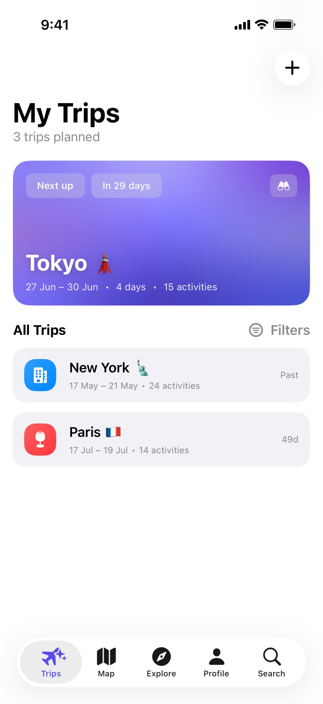
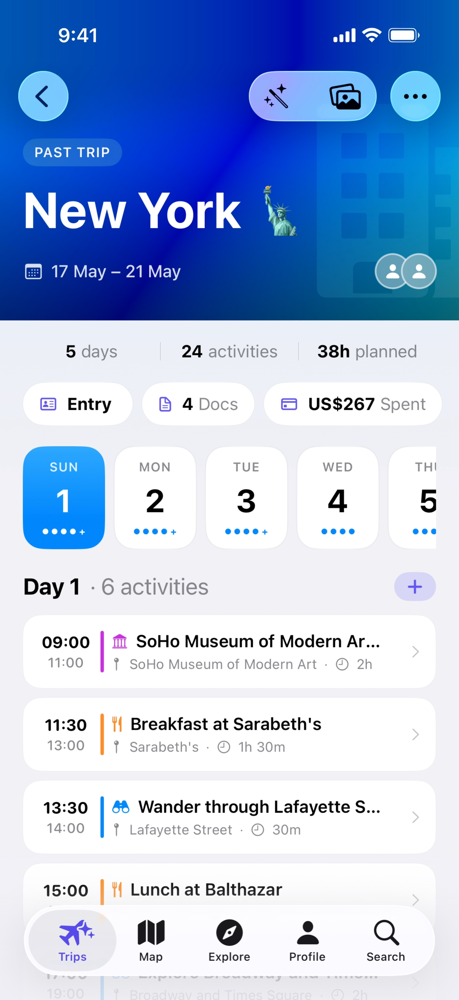
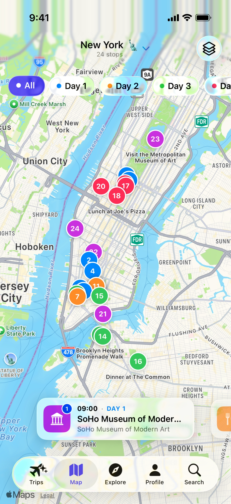

  

<h1 align="center">Navora</h1>

<strong>Turn places you want to visit into a trip you can follow.</strong>

  A travel app built with Swift and SwiftUI by Santiago Garza.

  <a href="https://apps.apple.com/mx/app/navora-planificador-de-viajes/id6780127016">View on the App Store</a>
  ·
  <a href="docs/engineering.md">Engineering case study</a>
  ·
  <a href="https://www.linkedin.com/in/sntggrz/">Connect with me</a>

> **Product showcase · Private source code**  
> This repository presents Navora's experience and selected engineering decisions. The application source code remains private.

## The app

Navora helps travelers turn places they want to visit into an organized trip—and keep that plan useful while traveling. It brings daily itineraries, maps, shared plans, travel documents, and expenses into one app.

## A look inside

<table>
  <tr>
    <th>Your trips</th>
    <th>Each day's plan</th>
    <th>Places on the map</th>
  </tr>
  <tr>
    <td></td>
    <td></td>
    <td></td>
  </tr>
</table>

*Screenshots from selected app builds; the interface may change between versions.*

## What you can do

- **Plan each day.** Discover places, add activities, import itineraries, or use AI planning to build a schedule around your interests and pace.
- **Adapt on the go.** Use **Rescue My Day** to replace a closed attraction or find something to do during free time.
- **Coordinate with others.** Share trips and collaborate on the itinerary.
- **Keep essentials together.** Store travel documents and track shared expenses with **Premium**.

AI features depend on device and Apple Intelligence availability.

## My role

I'm Santiago Garza, a software engineer and development lead based in Monterrey, México. Navora is my personal travel app, built alongside my work at Advant.

My development work on Navora spans the SwiftUI interface, trip data and persistence, planning flows, and native Apple integrations. It brings together my interests in mobile development and software that makes complex workflows easier to manage.

## Built with

| Technology | Role in Navora |
| --- | --- |
| **Swift · SwiftUI** | Application logic and native interface |
| **SwiftData** | App-facing trip models and persistence |
| **Core Data · CloudKit** | Personal and shared trip storage, synchronization, and collaboration |
| **MapKit** | Place discovery and itinerary maps |
| **Foundation Models** | AI-assisted itinerary generation and structured extraction |
| **Vision** | Text recognition for receipt scanning |

## Engineering highlights

- **Planning around the destination.** Trip dates and day boundaries use the destination's calendar and timezone.
- **Reviewable schedule changes.** The closed-attraction Rescue flow previews changes before applying them and checks for conflicting edits.
- **Collaboration-aware data.** Personal and shared trips have distinct storage boundaries and permission checks.
- **Clear expense totals.** Shared costs support different split methods, with balances kept separate by currency.

Read the [engineering case study](docs/engineering.md) for the problems behind these decisions and their tradeoffs.

## Try Navora or get in touch

- [Navora: Planificador de Viajes on the App Store](https://apps.apple.com/mx/app/navora-planificador-de-viajes/id6780127016)
- [Santiago Garza on LinkedIn](https://www.linkedin.com/in/sntggrz/)
- [Email me](mailto:sntggrz@hotmail.com)

This is a documentation and media showcase, not an open-source release of Navora.
